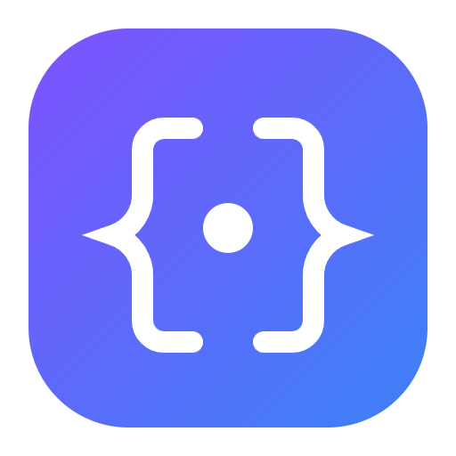

# kmp-hutool

<p align="center"></p>

Hutool's utilities rewritten for Kotlin Multiplatform: one `commonMain` source set for the JVM,
JavaScript, WebAssembly and Kotlin/Native.

[English](README.md) | [简体中文](README.zh-CN.md)

**[Documentation](https://shijianjs.github.io/kmp-hutool/)** ·
**[Live demo](https://shijianjs.github.io/kmp-hutool/demo/)** ·
**[API reference](https://shijianjs.github.io/kmp-hutool/api/)**

## Platforms

| Target | Tests run on |
| --- | --- |
| `jvm` | every CI run |
| `js` (Node.js), `wasmJs` (Node.js) | Linux CI |
| `linuxX64`, `linuxArm64` | `linuxX64` on Linux CI; `linuxArm64` klib built from any host |
| `mingwX64` | Windows CI |
| `macosX64`, `macosArm64`, `iosX64`, `iosArm64`, `iosSimulatorArm64` | macOS CI (the host's own arch); all klibs built from any host |

All targets are declared, so a checkout on any OS compiles the klibs for the others and catches a
portability mistake early. A Kotlin/Native test binary can only be linked and run on its own host
family, so the build disables foreign test tasks and CI runs each OS's own suite.

## What it is

A port of the portable part of [Hutool](https://github.com/chinabugotech/hutool) `5.8.48`. The
Kotlin code is not a line-by-line copy: merged facades, `kotlinx-datetime` value types, explicit
`toXxx` conversions and `data class` value objects replace the Java idioms that cannot cross into
common code. Reflection, `java.io`, threads, AWT, `BigDecimal` and `java.util.stream` are not ported
and every dropped class is recorded with a reason.

Coverage is measured against all 1557 upstream Java classes. The current numbers, and the reason for
each excluded class, are regenerated by `scripts/hutool_coverage.py` into
[docs/development/coverage.md](docs/development/coverage.md) and onto the documentation site.

## Modules

| Module | Artifact | Role |
| --- | --- | --- |
| `kmp-hutool-core` | `io.github.shijianjs:kmp-hutool-core:5.8.48-kt.1` | the library: `commonMain` utilities, tested on JVM, Node.js, Wasm and native hosts |
| `demo` | — | the browser demo, English/Chinese, published under `/demo/` |
| `docs` | — | this documentation site, built with [ktjs-docusaurus](https://github.com/shijianjs/ktjs-docusaurus) |

The core depends only on `kotlinx-datetime`. Larger areas of Hutool stay optional: when a feature
needs a Kotlin Multiplatform library, you add it yourself.

## Build

```bash
./gradlew :kmp-hutool-core:jvmTest   # unit tests on the JVM
./gradlew :kmp-hutool-core:jsTest    # the same tests on Node.js
./gradlew :kmp-hutool-core:allTests  # everything this host can run, including its native suite
./gradlew :docs:docusaurusBuild      # the documentation site
./gradlew :demo:jsBrowserDistribution # the demo bundle
./gradlew pagesSite                  # docs + demo + API for GitHub Pages
python scripts/hutool_inventory.py   # refresh the upstream class inventory
python scripts/hutool_coverage.py    # refresh the coverage report
```

A JDK 21+, Node and Python 3 are enough. Local Maven/npm mirrors belong in `~/.gradle/init.d` and
`~/.npmrc`; the repository's build files deliberately point at the public registries so CI stays
reproducible.

## Licensing

This port is MIT licensed (`LICENSE`). It derives from Hutool, which is licensed under the **Mulan
Permissive Software License v2**; the derived classes stay under that license, and `NOTICE` records
the upstream project, version and copyright. See
[the licensing page](https://shijianjs.github.io/kmp-hutool/guide/licensing) before redistributing.
