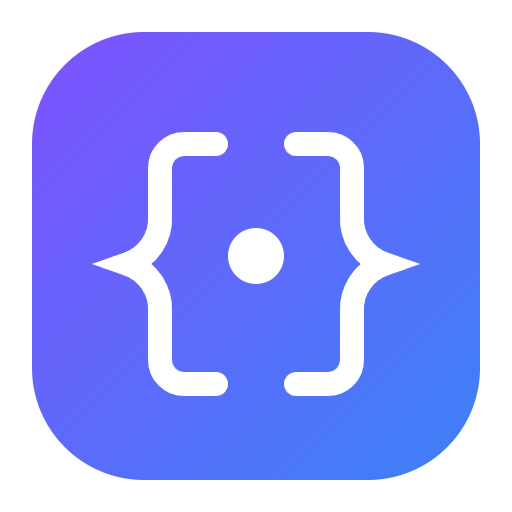

# kmp-hutool

<p align="center"></p>

Hutool 工具库的 Kotlin Multiplatform 改写版：JVM、JavaScript、WebAssembly 与 Kotlin/Native 共用同一份 `commonMain` 源码。

[English](README.md) | [简体中文](README.zh-CN.md)

**[文档](https://shijianjs.github.io/kmp-hutool/)** ·
**[在线演示](https://shijianjs.github.io/kmp-hutool/demo/)** ·
**[API 文档](https://shijianjs.github.io/kmp-hutool/api/)**

## 平台

| 目标 | 测试运行位置 |
| --- | --- |
| `jvm` | 每次 CI |
| `js`（Node.js）、`wasmJs`（Node.js） | Linux CI |
| `linuxX64`、`linuxArm64` | `linuxX64` 在 Linux CI；`linuxArm64` 的 klib 任意宿主可编 |
| `mingwX64` | Windows CI |
| `macosX64`、`macosArm64`、`iosX64`、`iosArm64`、`iosSimulatorArm64` | macOS CI（宿主自身架构）；klib 任意宿主可编 |

所有目标都会声明，因此在哪台机器检出都会顺带编译其他平台的 klib，可移植性问题能早暴露。原生测试二进制只能在同族宿主上链接运行，所以构建脚本禁用非宿主测试，由各 OS 的 CI 各跑自己那套。

## 这是什么

移植 [Hutool](https://github.com/chinabugotech/hutool) `5.8.48` 中可跨平台的部分。Kotlin 代码不是逐行照抄：合并门面、`kotlinx-datetime` 值类型、显式 `toXxx` 转换、`data class` 值对象，取代那些搬不进 common 代码的 Java 习惯。反射、`java.io`、线程、AWT、`BigDecimal`、`java.util.stream` 不移植，每个放弃的类都在清单里写明理由。

覆盖率以上游全部 1557 个 Java 类为基数；当前数字与每个排除项的理由由 `scripts/hutool_coverage.py` 重新生成，写入 [docs/development/coverage.md](docs/development/coverage.md) 并同步到文档站。

## 模块

| 模块 | 坐标 | 作用 |
| --- | --- | --- |
| `kmp-hutool-core` | `io.github.shijianjs:kmp-hutool-core:5.8.48-kt.1` | 库本体：`commonMain` 工具类，JVM、Node.js、Wasm 与原生宿主都有测试 |
| `demo` | — | 浏览器演示页，中英文可切换，发布在 `/demo/` |
| `docs` | — | 本文档站，由 [ktjs-docusaurus](https://github.com/shijianjs/ktjs-docusaurus) 构建 |

核心只依赖 `kotlinx-datetime`。Hutool 里更大的领域保持可选：某个功能需要 KMP 库时，由使用方自行添加。

## 构建

```bash
./gradlew :kmp-hutool-core:jvmTest    # JVM 单元测试
./gradlew :kmp-hutool-core:jsTest     # 同一套测试在 Node.js 上跑
./gradlew :kmp-hutool-core:allTests  # 当前宿主能跑的全部测试，含本地原生套件
./gradlew :docs:docusaurusBuild       # 文档站
./gradlew :demo:jsBrowserDistribution # 演示页产物
./gradlew pagesSite                   # 文档 + 演示 + API，GitHub Pages 布局
python scripts/hutool_inventory.py    # 刷新上游类清单
python scripts/hutool_coverage.py     # 刷新覆盖率报告
```

只需要 JDK 21+、Node 与 Python 3。本地 Maven/npm 镜像放 `~/.gradle/init.d` 与 `~/.npmrc`；仓库构建脚本刻意指向公共仓库，保证 CI 可复现。

## 许可

本项目采用 MIT（`LICENSE`）。代码衍生自 Hutool，上游采用 **木兰宽松许可证第 2 版**（Mulan PSL v2）；衍生类保持该许可，`NOTICE` 记录了上游项目、版本与版权。再分发前请阅读[许可证页面](https://shijianjs.github.io/kmp-hutool/zh-Hans/guide/licensing)。
