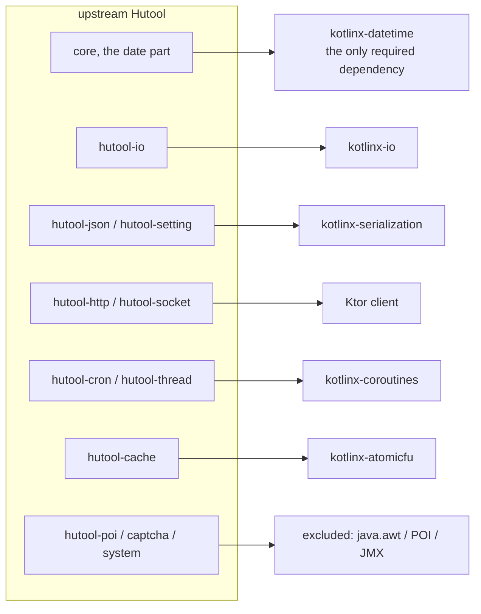

# Ecosystem & optional dependencies

`kmp-hutool-core` deliberately keeps a **single hard dependency** — `kotlinx-datetime` — and leaves every
other capability to the official Kotlin Multiplatform ecosystem. Add a library only when you actually
use that capability; nothing here is pulled in transitively.

This is the KMP counterpart of Hutool's "one jar, everything inside" model: the JVM modules that
Hutool implements itself (`hutool-io`, `hutool-json`, `hutool-http`, …) are already mature,
multiplatform libraries in the Kotlin ecosystem, and duplicating them inside a `commonMain` port would
mean maintaining a second, worse version.



## Mapping

| Hutool module / feature | Recommended KMP library | Nature | Notes |
| --- | --- | --- | --- |
| `hutool-core` date/time helpers | [`kotlinx-datetime`](https://github.com/Kotlin/kotlinx-datetime) | **required** | The only dependency of `kmp-hutool-core`. `DateUtil`/`DateTime` are not ported; use `LocalDateTime`/`Instant`/`TimeZone`. |
| `hutool-io` (`FileUtil`, streams, `IoUtil`) | [`kotlinx-io`](https://github.com/Kotlin/kotlinx-io) | optional | Buffers, sources and sinks across JVM/JS/Native. The `io` packages are excluded from this port. |
| `hutool-json`, `hutool-setting` parsing | [`kotlinx-serialization`](https://github.com/Kotlin/kotlinx.serialization) | optional | Compile-time serializers for JSON, properties-like formats and custom formats. |
| `hutool-http`, `hutool-socket` | [`Ktor`](https://github.com/ktorio/ktor) client | optional | HTTP engines per platform; also covers WebSocket and server-side engines. |
| `hutool-cron`, async helpers, `hutool-thread` scheduling | [`kotlinx-coroutines`](https://github.com/Kotlin/kotlinx.coroutines) | optional | Structured concurrency + `delay`-based schedulers; no thread API in `commonMain`. |
| `hutool-cache` concurrent maps | [`kotlinx-atomicfu`](https://github.com/Kotlin/kotlinx.atomicfu) | optional | Atomic references where a platform cache needs lock-free state. |
| `hutool-crypto` digests/ciphers | platform `expect`/`actual` or a KMP crypto library | optional | `MessageDigest`/`Cipher` are JVM APIs; keep digests behind an interface. |
| `hutool-poi`, `hutool-captcha`, `hutool-system` | — | excluded | Depend on `java.awt`, Apache POI or JMX; not portable by design. |

Version selection: check the library page on [klibs.io](https://klibs.io) for the current stable release
and the target matrix before adding it, rather than copying a version from a README.

```kotlin
// build.gradle.kts of a consumer project
commonMain.dependencies {
    implementation("io.github.shijianjs:kmp-hutool-core:5.8.48-kt.1")
    // add only what the feature you use needs
    implementation("org.jetbrains.kotlinx:kotlinx-io-core:<version>")
}
```

## What this port does *not* do

- It does not re-implement a JSON parser, HTTP client, file system or scheduler. Those live in the
  libraries above and stay optional.
- It does not expose JVM-only signatures (`Charset`, `java.io`, `java.lang.reflect`) that would force a
  platform-specific dependency on every consumer.
- It does not silently pull a heavy dependency into your graph: everything except
  `kotlinx-datetime` must be added explicitly.

See [Design decisions](./design.md) for the exclusion rules and [Coverage](./coverage.md) for the
per-class status, including the reason each excluded class was left out.
