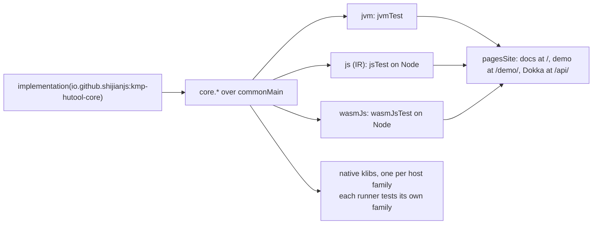

# Getting started

## Requirements

- Kotlin 2.2 or newer for the consuming project (the library is authored with Kotlin 2.4.21).
- One of the published targets: `jvm`, `js` (IR), `wasmJs`.
- Tests are written with `kotlin("test")`, so the same suite runs on every target.

## Add the dependency

```kotlin
kotlin {
    jvm()
    js { nodejs() }
    wasmJs { nodejs() }
    sourceSets {
        commonMain.dependencies {
            implementation("io.github.shijianjs:kmp-hutool-core:5.8.48-kt.1")
        }
    }
}
```

The version constant lives in `gradle.properties` as `kmp-hutool.version`. A `-kt.N` suffix marks the
N-th Kotlin rewrite of upstream `5.8.48`; a new upstream version starts a new `5.8.x-kt.1`.



## First calls

Everything lives under `io.github.shijianjs.kmphutool`, mirroring Hutool's package layout
(`core.util`, `core.text`, `core.collection`, `core.codec`, ...):

```kotlin
import io.github.shijianjs.kmphutool.core.util.StrUtil
import io.github.shijianjs.kmphutool.core.util.NumberUtil
import io.github.shijianjs.kmphutool.core.collection.CollUtil

fun main() {
    println(StrUtil.format("{} has {} items", "cart", 3))
    println(StrUtil.upperFirst("kotlin"))        // Kotlin
    println(NumberUtil.format(1_234_567.891, 2)) // 1,234,567.89
    println(CollUtil.join(listOf(1, 2, 3), "-")) // 1-2-3
}
```

Where a Kotlin idiom reads better than a static helper, the port offers it as well:

```kotlin
val parts = "a, b ,c".splitTrim(",")
val name = "  kotlin  ".trimIndentSafe() // see StrUtil
val code = "42".toIntOrNull() ?: 0
```

## Optional dependencies

`kmp-hutool-core` depends only on `kotlinx-datetime`, and only for date types. Everything outside the
core (JSON, HTTP, crypto, database, POI, ...) is **not** bundled. When a feature needs a package from
the kotlinx family or another Kotlin Multiplatform library, you add that package yourself; nothing in
`commonMain` pulls it in transitively. The [module page](../modules/core.md) lists what each area
needs when an optional dependency becomes necessary.

## Build from source

```bash
./gradlew :kmp-hutool-core:jvmTest   # unit tests on the JVM
./gradlew :kmp-hutool-core:jsTest    # the same tests on Node.js
./gradlew :docs:docusaurusBuild      # this documentation site
./gradlew pagesSite                  # docs + demo + API, the layout GitHub Pages serves
```

Mirror configuration for a slow network belongs in **your own** `~/.gradle/init.d/*.gradle.kts` and
`~/.npmrc`; the repository's build files must keep pointing at the public registries so CI stays
reproducible. [Design](design.md) explains the layout in more detail.
