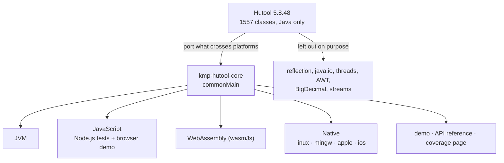

# kmp-hutool

`kmp-hutool` is [Hutool](https://github.com/chinabugotech/hutool)'s utility collection rewritten for
Kotlin Multiplatform. It targets JVM, JavaScript, WebAssembly and Kotlin/Native from one `commonMain`
source set, so the same string, collection, number, date and encoding helpers run on a server, in a
browser, on Node.js, and on desktop, iOS, Android or Linux binaries.

## Platforms

| Target | Notes |
| --- | --- |
| JVM | the widest surface; `jvmTest` runs first in CI |
| JavaScript | Node.js tests, plus the browser demo |
| WebAssembly (wasmJs) | Node.js tests |
| `linuxX64`, `linuxArm64` | klib compiled from any host, tests run on Linux CI |
| `mingwX64` | tests run on Windows CI |
| `macosX64`, `macosArm64`, `iosX64`, `iosArm64`, `iosSimulatorArm64` | klib compiled from any host, tests run on macOS CI |

Every target is declared in `kmp-hutool-core/build.gradle.kts`, so a checkout on one OS still compiles
the klibs for the others and surfaces a portability mistake early. A native test executable can only
be linked and run on its own host family, so foreign test tasks are disabled in the build script and
each OS's CI job runs its own suite.

The port is not a mechanical copy. Java-only capabilities (reflection, `java.io`, threads, AWT,
`BigDecimal`, streams) are left out, and where Kotlin has a better idiom the API uses it — merged
facades instead of parallel `Util` classes, `kotlinx-datetime` instead of `java.util.Date`, explicit
`toXxx` conversions instead of a reflective type registry. [Design](guide/design.md) explains each
decision.

## What you get

| Part | Role |
| --- | --- |
| `kmp-hutool-core` | the library: `commonMain` implementations of the portable Hutool core classes, tested on JVM and JS |

| [Demo](https://shijianjs.github.io/kmp-hutool/demo/) | a runnable page that calls the library in the browser, switchable between English and Chinese |
| [API](https://shijianjs.github.io/kmp-hutool/api/) | Dokka reference for every public declaration |
| [Coverage](guide/coverage.md) | the class-by-class inventory, the ported count and the reason for every exclusion |

## Status

The library is at `5.8.48-kt.1`, tracking Hutool `5.8.48`. Coverage is measured against the 1557
classes in the upstream repository; the [coverage page](guide/coverage.md) is regenerated by
`scripts/hutool_coverage.py` on every run, so the numbers there are never hand-maintained.

## Where to go next

- [Getting started](guide/getting-started.md) — add the dependency and call the first helpers.
- [Design](guide/design.md) — what was ported, what was rewritten, what was dropped.
- [Licensing](guide/licensing.md) — MIT for this port, Mulan PSL v2 for the upstream code it derives from.
