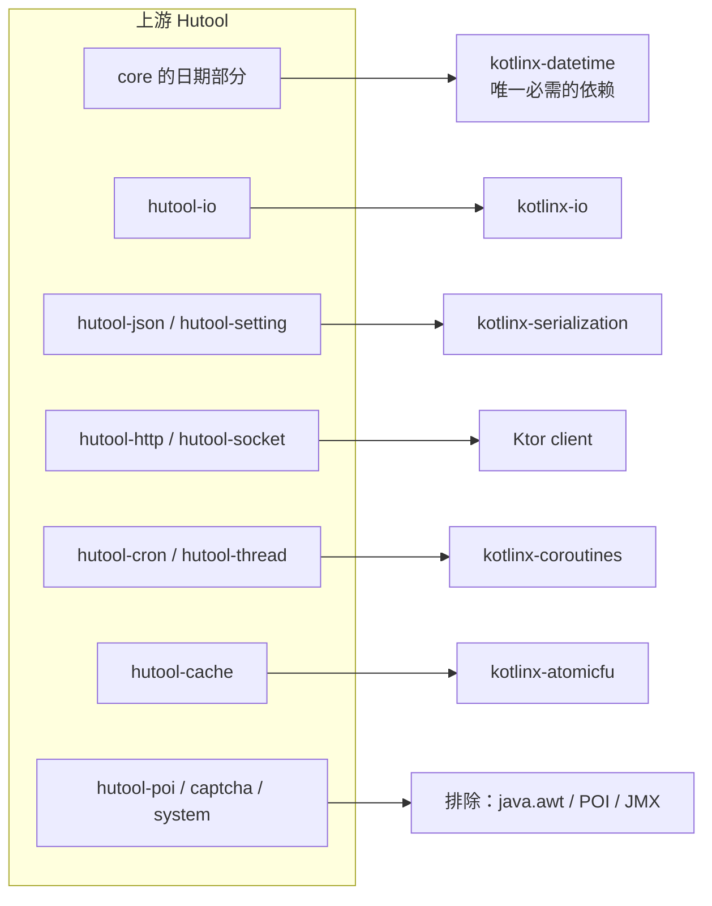

# 生态与可选依赖

`kmp-hutool-core` 有意只保留**一个硬依赖**——`kotlinx-datetime`——其他能力全部交给 Kotlin 多平台官方生态。
用到哪项能力再加对应库，任何一项都不会被传递依赖进来。

这是 Hutool「一个大 jar 全包」模式在 KMP 下的对应做法：Hutool 自己实现的 JVM 模块
（`hutool-io`、`hutool-json`、`hutool-http` 等）在 Kotlin 生态里都已有成熟的多平台库，
在 `commonMain` 里再实现一遍等于维护一个更差的第二版本。



## 对应关系

| Hutool 模块 / 能力 | 推荐 KMP 库 | 性质 | 说明 |
| --- | --- | --- | --- |
| `hutool-core` 日期时间工具 | [`kotlinx-datetime`](https://github.com/Kotlin/kotlinx-datetime) | **必需** | `kmp-hutool-core` 唯一依赖。`DateUtil`/`DateTime` 不做移植，请用 `LocalDateTime`/`Instant`/`TimeZone`。 |
| `hutool-io`（`FileUtil`、流、`IoUtil`） | [`kotlinx-io`](https://github.com/Kotlin/kotlinx-io) | 可选 | 跨 JVM/JS/Native 的 buffer、source、sink；本项目的 `io` 包全部排除。 |
| `hutool-json`、`hutool-setting` 解析 | [`kotlinx-serialization`](https://github.com/Kotlin/kotlinx.serialization) | 可选 | 编译期序列化器，覆盖 JSON、类 properties 格式与自定义格式。 |
| `hutool-http`、`hutool-socket` | [`Ktor`](https://github.com/ktorio/ktor) 客户端 | 可选 | 各平台 HTTP 引擎，也覆盖 WebSocket 与服务端引擎。 |
| `hutool-cron`、异步工具、`hutool-thread` 调度 | [`kotlinx-coroutines`](https://github.com/Kotlin/kotlinx.coroutines) | 可选 | 结构化并发 + 基于 `delay` 的调度；`commonMain` 没有线程 API。 |
| `hutool-cache` 并发 Map | [`kotlinx-atomicfu`](https://github.com/Kotlin/kotlinx.atomicfu) | 可选 | 需要无锁状态的平台缓存可用原子引用。 |
| `hutool-crypto` 摘要/加密 | 平台 `expect`/`actual` 或 KMP 加密库 | 可选 | `MessageDigest`/`Cipher` 是 JVM API，摘要应放在接口后面。 |
| `hutool-poi`、`hutool-captcha`、`hutool-system` | — | 排除 | 依赖 `java.awt`、Apache POI 或 JMX，设计上不可移植。 |

版本选择：加依赖前先查该库在 [klibs.io](https://klibs.io) 上的最新稳定版本与 target 矩阵，
不要直接抄 README 里的版本号。

```kotlin
// 使用方项目的 build.gradle.kts
commonMain.dependencies {
    implementation("io.github.shijianjs:kmp-hutool-core:5.8.48-kt.1")
    // 只加你实际用到的能力
    implementation("org.jetbrains.kotlinx:kotlinx-io-core:<version>")
}
```

## 本项目刻意不做的事

- 不重新实现 JSON 解析、HTTP 客户端、文件系统或调度器——它们属于上面的库，且保持可选。
- 不暴露 `Charset`、`java.io`、`java.lang.reflect` 这类 JVM 专属签名，否则会给每个使用方强加平台依赖。
- 不把重依赖悄悄带进依赖图：除 `kotlinx-datetime` 外，其它都必须显式添加。

排除规则见[设计取舍](./design.md)，逐类状态与排除理由见[覆盖率](./coverage.md)。
