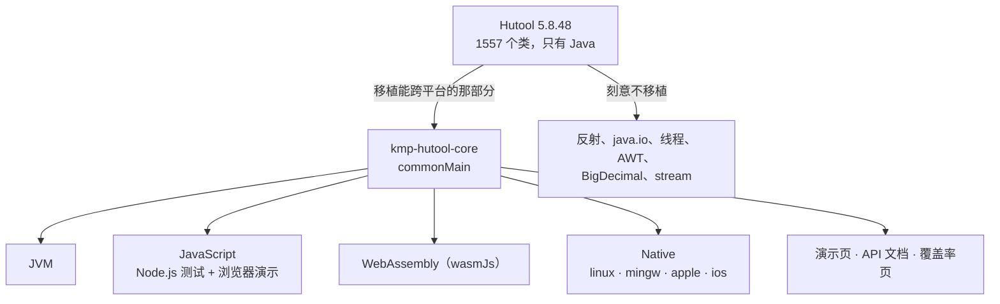

# kmp-hutool

`kmp-hutool` 是 [Hutool](https://github.com/chinabugotech/hutool) 工具库的 Kotlin Multiplatform 改写版。目标是 JVM、JavaScript、WebAssembly 与 Kotlin/Native 共用同一份 `commonMain` 源码，使字符串、集合、数字、日期、编码这些工具在服务端、浏览器、Node.js 以及桌面、iOS、Android、Linux 二进制里行为一致。

## 平台

| 目标 | 说明 |
| --- | --- |
| JVM | 能力最全，CI 先跑 `jvmTest` |
| JavaScript | Node.js 测试，外加浏览器演示页 |
| WebAssembly（wasmJs） | Node.js 测试 |
| `linuxX64`、`linuxArm64` | 任意宿主都能编 klib，测试在 Linux CI 跑 |
| `mingwX64` | 测试在 Windows CI 跑 |
| `macosX64`、`macosArm64`、`iosX64`、`iosArm64`、`iosSimulatorArm64` | 任意宿主都能编 klib，测试在 macOS CI 跑 |

所有目标都在 `kmp-hutool-core/build.gradle.kts` 里声明，因此随便哪台机器检出都会顺带编译其他平台的 klib，可移植性问题能早暴露。原生测试二进制只能在同族宿主上链接和运行，所以构建脚本会禁用非宿主测试，由各 OS 的 CI 任务跑自己的那套。

这不是逐行照搬：只依赖 Java 的能力（反射、`java.io`、线程、AWT、`BigDecimal`、stream）不移植；Kotlin 有更自然写法的地方直接改用 Kotlin 写法——合并门面类、用 `kotlinx-datetime` 取代 `java.util.Date`、用显式 `toXxx` 取代反射类型注册表。每个取舍都写在[设计](guide/design.md)里。

## 组成

| 部分 | 作用 |
| --- | --- |
| `kmp-hutool-core` | 库本体：`commonMain` 里可移植的 Hutool 核心类，JVM、JS、Wasm 与 Native 都有测试 |

| [演示](https://shijianjs.github.io/kmp-hutool/demo/) | 浏览器里直接调用本库的页面，中英文可切换 |
| [API](https://shijianjs.github.io/kmp-hutool/api/) | Dokka 生成的公开声明文档 |
| [覆盖率](guide/coverage.md) | 按类盘点的清单、已完成数量，以及每个排除项的理由 |

## 现状

版本 `5.8.48-kt.1`，对应上游 Hutool `5.8.48`。覆盖率以上游仓库 1557 个类为基数，[覆盖率页面](guide/coverage.md)由 `scripts/hutool_coverage.py` 每次运行时重新生成，数字不靠手工维护。

## 接下来

- [快速开始](guide/getting-started.md)——加依赖、跑第一个例子。
- [设计](guide/design.md)——移植了什么、改写在哪里、放弃了什么。
- [许可证](guide/licensing.md)——本项目 MIT，上游代码 Mulan PSL v2。
